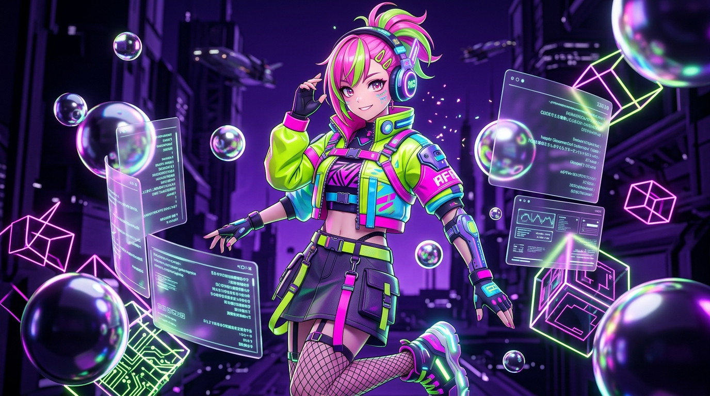
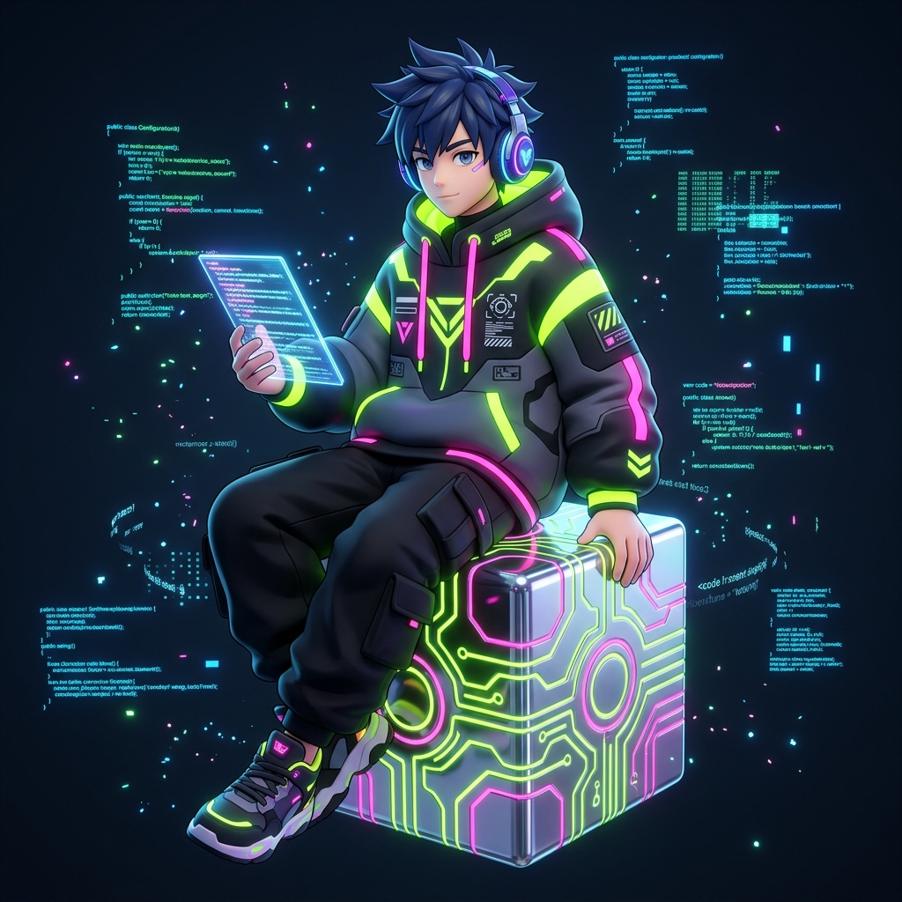
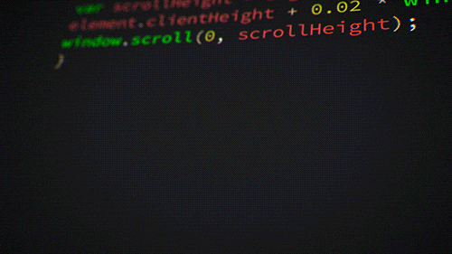
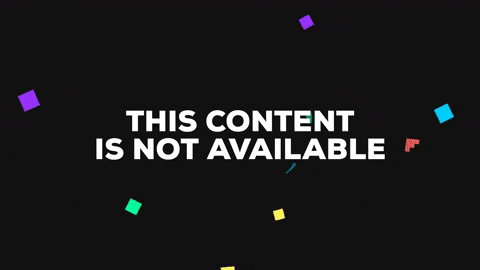

  <!-- ==================== CYBER-POP GEN-Z 3D ANIME BANNER ==================== -->
  

    

  <!-- ==================== STYLIZED TITLE & TAGLINE ==================== -->
  <h1>
    
     DHARMENDER KUMAR 
    
  </h1>

  

    <code>⚡ FULL-STACK SYSTEMS ARCHITECT // APPLIED AI & VISION BUILDER // ダーメンダー・クマール ⚡</code>
  

  <!-- ==================== DYNAMIC ORBITRON NEON LIME TYPING ==================== -->
  

    

  <!-- ==================== CYBER-POP PILL BADGES ==================== -->
  

    
    &nbsp;&nbsp;
    
    &nbsp;&nbsp;
    
    &nbsp;&nbsp;
    
  

 

<!-- ==================== 01 : ABOUT ME ==================== -->

  

<table border="0" width="100%">
  <tr>
    <td width="35%" align="center" valign="middle">
      
       
      <code>[ STATUS : 100% ONLINE &bull; READY TO SHIP ]</code>
    </td>
    <td width="65%" valign="top">
      <h3>👾 Konnichiwa! I'm Dharmender</h3>
      

        I am a <b>Full-Stack Developer</b> and <b>Applied AI Engineer</b> building high-performance, offline-first architectures, real-time computer vision pipelines, and human-centric software.
      

      <ul>
        <li>🚀 <b>Vibe Check</b>: Architecting resilient crisis response software, clinical accessibility AI, and multimodal tools.</li>
        <li>🔮 <b>Core Arsenal</b>: Full-Stack Web (<b>React, Node.js, Express, PostgreSQL</b>), Cross-Platform Mobile (<b>Flutter</b>), and Vision (<b>OpenCV, MediaPipe</b>).</li>
        <li>🧠 <b>Level Up</b>: Grinding Data Structures & Algorithms in <b>Java</b> + exploring modern Agentic LLM workflows.</li>
        <li>🎯 <b>Manifesto</b>: Build fast, write clean code, prioritize offline availability, and create real human impact.</li>
      </ul>
    </td>
  </tr>
</table>

 

<!-- ==================== 02 : TECH MATRIX ==================== -->

  

  

     
     
     
     
    
  

 

| DOMAIN | TECHNOLOGIES & TOOLS |
| :--- | :--- |
| **Languages** | Python &bull; Java (DSA) &bull; JavaScript (ES6+) &bull; TypeScript &bull; C/C++ &bull; SQL |
| **Frontend & Mobile** | React.js &bull; Flutter (Dart) &bull; Tailwind CSS &bull; Bootstrap 5 &bull; Redux |
| **Backend & Cloud** | Node.js &bull; Express.js &bull; RESTful Microservices &bull; Firebase &bull; Docker |
| **AI & Computer Vision** | OpenCV &bull; MediaPipe &bull; TensorFlow &bull; Google Gemini API &bull; OCR |
| **Databases** | PostgreSQL &bull; MongoDB &bull; MySQL &bull; Firebase Firestore Cloud |
| **DevOps & Workflow** | Git &bull; GitHub Actions &bull; Linux (Debian/Arch) &bull; Postman &bull; VS Code &bull; Figma |

 

<!-- ==================== 03 : FEATURED MISSIONS ==================== -->

  

<table border="0" width="100%">
  <tr>
    <td width="58%" valign="top">
      <h3>🚨 <a href="https://github.com/dkt882/releiflink">ReliefLink</a></h3>
      
<b>Disaster-Response & Crisis Triage Mesh Platform</b>

      

        
        
        
        
      

      <ul>
        <li><b>Resilient Outbox Sync:</b> Zero-downtime offline-first synchronization queue maintaining operation during cellular blackouts.</li>
        <li><b>Dynamic Priority Matrix:</b> Multi-tier crisis scoring algorithm prioritizing urgent humanitarian requests.</li>
        <li><b>Geographic Dispatch:</b> Proximity-based matching engine pairing nearby responders with emergency coordinates.</li>
      </ul>
      
🔗 <a href="https://github.com/dkt882/releiflink"><b>[ ACCESS REPOSITORY SOURCE ] &rarr;</b></a>

    </td>
    <td width="42%" align="center" valign="middle">
      
       
      <code>DISPATCH_MATRIX : TRIAGE MESH</code>
    </td>
  </tr>
  <tr>
    <td width="58%" valign="top">
      <h3>🩺 MediSign AI</h3>
      
<b>Multimodal Assistive Healthcare Suite</b>

      

        
        
        
        
      

      <ul>
        <li><b>Universal Accessibility:</b> Translates sign language into synthetic speech for deaf & speech-impaired patients.</li>
        <li><b>Bi-Directional Communication:</b> Real-time Speech-to-Text conversion for doctor responses with captions.</li>
        <li><b>Prescription OCR:</b> Automated extraction and digitizing of handwritten medical reports.</li>
      </ul>
    </td>
    <td width="42%" align="center" valign="middle">
      
       
      <code>VISION_CORE : CLINICAL HUD</code>
    </td>
  </tr>
  <tr>
    <td width="58%" valign="top">
      <h3>🖐️ 3D Sign Language Interpreter</h3>
      
<b>Real-Time Kinetic Gesture-to-Speech Engine</b>

      

        
        
        
        
      

      <ul>
        <li><b>Landmark Tracking:</b> 21-coordinate 3D spatial hand skeletal extraction utilizing MediaPipe neural graphs.</li>
        <li><b>Gesture Classification:</b> Deep learning model classifying dynamic signs at high frame rates.</li>
        <li><b>Instant Voice Synthesis:</b> Low-latency vocal synthesis bridging interpersonal communication.</li>
      </ul>
    </td>
    <td width="42%" align="center" valign="middle">
      
       
      <code>GESTURE_SYNC : HIGH-FPS PIPELINE</code>
    </td>
  </tr>
  <tr>
    <td width="58%" valign="top">
      <h3>🎤 Mukh-Lipi (मुख-लिपि)</h3>
      
<b>Voice-Driven Vernacular Form & Document AI</b>

      

        
        
        
        
      

      <ul>
        <li><b>Vernacular Speech Mapping:</b> Translates conversational regional dialects into structured digital form fields.</li>
        <li><b>Intent Extraction:</b> Leverages Gemini Multimodal API to parse complex context and clean acoustic distortion.</li>
        <li><b>Document OCR Verification:</b> Automated verification and text extraction from identity cards.</li>
      </ul>
    </td>
    <td width="42%" align="center" valign="middle">
      
       
      <code>VOICE_AI : MULTIMODAL SYNTH</code>
    </td>
  </tr>
  <tr>
    <td width="58%" valign="top">
      <h3>🛒 E-Commerce Storefronts</h3>
      
<b>Scalable Web Storefronts & Payment Gateways</b>

      

        
        
        
      

      <ul>
        <li><b>Engineered Storefronts:</b> Fast responsive UI optimized for micro-interactions and smooth checkout velocity.</li>
        <li><b>Automated Processing:</b> Webhook-driven payment reconciliation and inventory tracking.</li>
      </ul>
    </td>
    <td width="42%" align="center" valign="middle">
      
       
      <code>AUTOMATION_CORE : DISPATCH BOT</code>
    </td>
  </tr>
</table>

 

<!-- ==================== 04 : ACTIVITY & TELEMETRY ==================== -->

  

  <picture>
    <source media="(prefers-color-scheme: dark)" srcset="https://raw.githubusercontent.com/dkt882/dkt882/output/github-contribution-grid-snake-dark.svg">
    <source media="(prefers-color-scheme: light)" srcset="https://raw.githubusercontent.com/dkt882/dkt882/output/github-contribution-grid-snake.svg">
    
  </picture>

 

  <table border="0">
    <tr>
      <td align="center" width="50%">
        
      </td>
      <td align="center" width="50%">
        
      </td>
    </tr>
  </table>

 

<!-- ==================== 05 : COMM-LINK ==================== -->

  

  
<b style="color:#CCFF00; font-size:16px;">Initiating secure transmission. Available for high-impact software missions, engineering collaborations, and AI architectures.</b>

  

    
    &nbsp;&nbsp;&nbsp;&nbsp;
    
    &nbsp;&nbsp;&nbsp;&nbsp;
    
  

   

  ⚡ Engineered with Cyber-Pop 3D Anime Aesthetics &bull; <b>Dharmender Kumar (dkt882)</b> &bull; 2026

